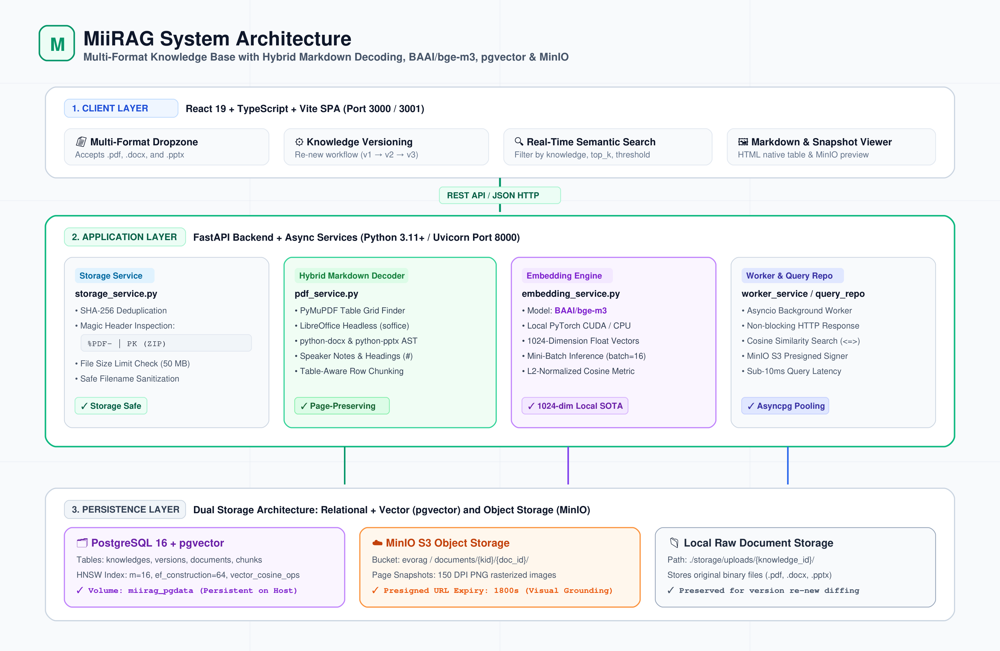
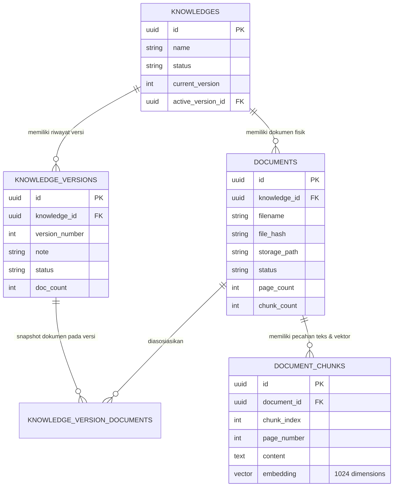

# Arsitektur Sistem MiiRAG

Dokumen ini menjelaskan arsitektur keseluruhan dari platform **MiiRAG** (*Multi-format Intelligent Ingestion Retrieval-Augmented Generation*). Dokumen ini ditujukan bagi developer atau tim teknis yang akan melanjutkan pengembangan atau mengelola sistem ini di masa mendatang.

---

## 1. Ikhtisar Arsitektur (Architecture Overview)

MiiRAG dirancang menggunakan pola **3-Tier Async Architecture** yang memisahkan antara antarmuka pengguna (Frontend), pemrosesan asynchronous non-blocking (Backend API & Ingestion Engine), serta lapisan penyimpanan ganda (*Dual Storage Layer*: relasional + vektor di PostgreSQL dan snapshot visual di MinIO).



> **Format Vektor:** Gambar diagram arsitektur di atas juga tersedia dalam format SVG tajam dan dapat di-zoom di [`docs/images/architecture_overview.svg`](images/architecture_overview.svg).

---

## 2. Lapisan Sistem (System Layers)

### A. Client Layer (Frontend SPA)
* **Teknologi:** React 19, TypeScript, Vite, CSS Native dengan CSS Variables (Dukungan Dark Mode & Light Mode).
* **Port Standar:** `http://localhost:3000` (atau `3001` jika port 3000 sedang terpakai).
* **Fitur Utama:**
  * **Multi-Format Dropzone:** Menerima unggahan dokumen `.pdf`, `.docx`, dan `.pptx` secara *drag-and-drop* atau *file picker*.
  * **Knowledge & Version Manager:** Mengelola siklus dokumen, status pemrosesan (`unfinished`, `processing`, `done`), serta pembaruan versi dokumen (*Re-new*).
  * **Semantic Search Console:** Antarmuka pencarian instan dengan filter Knowledge ID, penggeser *similarity threshold*, dan batasan `top_k`.
  * **Responsive Markdown & Snapshot Viewer:** Merender tabel data secara native (`<table>`), heading, list, inline code, serta tautan preview gambar snapshot halaman fisik dari MinIO.

### B. Application & Ingestion Layer (FastAPI Backend)
* **Teknologi:** Python 3.11+ (di-manage dengan `uv`), FastAPI, SQLAlchemy 2.0 (Asyncpg), Uvicorn.
* **Port Standar:** `http://localhost:8000` (Dokumentasi interaktif OpenAPI di `/docs`).
* **Komponen Service Utama:**
  1. [`app/services/storage_service.py`](../app/services/storage_service.py): Memvalidasi batas ukuran (50MB), memeriksa integritas *magic header* file (`%PDF-` untuk PDF, `PK\x03\x04` untuk arsip OpenXML DOCX/PPTX), dan menghitung SHA-256 hash.
  2. [`app/services/pdf_service.py`](../app/services/pdf_service.py): Mesin inti dekoder dokumen hibrida (*Page-Preserving Hybrid Markdown Decoder*), konversi LibreOffice headless, ekstraksi tabel PyMuPDF, AST parser untuk Word/PowerPoint, dan *table-aware chunking*.
  3. [`app/services/embedding_service.py`](../app/services/embedding_service.py): Menghasilkan dense vector berdimensi 1024 menggunakan model lokal `BAAI/bge-m3` via PyTorch CUDA/CPU dalam mini-batch 16. Dilengkapi fallback ke Google Vertex AI jika dibutuhkan.
  4. [`app/services/worker_service.py`](../app/services/worker_service.py): Mengelola antrean embedding di background secara asynchronous (`asyncio.create_task`) tanpa memblokir HTTP response, dilindungi oleh `asyncio.Lock` per knowledge untuk mencegah *race conditions*.
  5. [`app/services/minio_service.py`](../app/services/minio_service.py): Mengunggah gambar snapshot halaman/slide (PNG 150 DPI) ke MinIO dan menghasilkan secure presigned URL (masa berlaku 1800 detik / 30 menit) untuk visual grounding.
  6. [`app/services/query_service.py`](../app/services/query_service.py): Orkestrasi pipeline retrieval (*Query Enhancement* &rarr; *Hybrid Search RRF* &rarr; *Cross-Encoder Rerank* &rarr; *Context Window Expansion*). Lihat detail lengkap di [`RETRIEVAL_METHODS.md`](RETRIEVAL_METHODS.md).
  7. [`app/services/rerank_service.py`](../app/services/rerank_service.py): Menilai ulang Top-20 kandidat menggunakan model Cross-Encoder multilingual `cross-encoder/mmarco-mMiniLMv2-L12-H384-v1` (FP16 CUDA / CPU fallback).
  8. [`app/services/query_enhancement_service.py`](../app/services/query_enhancement_service.py): Mengelola **HyDE** (LLM opsional / fallback heuristik) dan **Query Expansion** kamus sinonim domain.

### C. Persistence & Storage Layer (Lapisan Penyimpanan)

#### 1. PostgreSQL 16 + pgvector
* Berjalan di container Docker: `miirag-pgvector` (Port 5432).
* Menggunakan *named volume* Docker `pgdata:/var/lib/postgresql/data` yang **persistent** di host machine (`/var/lib/docker/volumes/miirag_pgdata/_data`).
* **Indeks Vektor (Dense Semantic):** Menggunakan indeks **HNSW** (*Hierarchical Navigable Small World*) dengan operator `vector_cosine_ops` untuk pencarian sub-millisecond:
  ```sql
  CREATE INDEX idx_document_chunks_embedding_hnsw 
  ON document_chunks 
  USING hnsw (embedding vector_cosine_ops) 
  WITH (m = 16, ef_construction = 64);
  ```
* **Indeks Full-Text Search (Sparse Keyword):** Kolom `tsv tsvector GENERATED ALWAYS AS (...) STORED` mengindeks `contextual_header` + `content` dengan indeks **GIN**:
  ```sql
  CREATE INDEX idx_document_chunks_tsv_gin
  ON document_chunks USING gin (tsv);
  ```

#### 2. MinIO Object Storage
* **Bucket:** `evorag`
* **Struktur Objek:** `documents/{knowledge_id}/{doc_id}/page_{page_number}.png`
* **Tujuan:** Menyimpan gambar raster halaman/slide asli beresolusi 150 DPI agar pengguna maupun Multimodal LLM dapat melakukan *visual grounding* (melihat layout asli, bagan/flowchart, gambar, dan stempel dokumen).

#### 3. Local Upload Storage
* **Direktori:** `./storage/uploads/{knowledge_id}/`
* Menyimpan file asli yang diunggah untuk kebutuhan diffing saat penambahan versi baru (*re-new*).

---

## 3. Skema Data & Model Versioning

Sistem menggunakan model relasional yang mendukung **Document Versioning** tanpa duplikasi embedding yang tidak perlu:



### Mekanisme Hemat Komputasi (*Zero Re-Embedding Waste*)
Saat pengguna memperbarui dokumen pada suatu knowledge (*Re-new*):
1. Pengguna memilih dokumen lama yang tetap dipertahankan (`keep_document_ids`) dan mengunggah dokumen baru.
2. Versi baru dibuat (`v1` &rarr; `v2`).
3. Dokumen lama yang dipilih **tidak di-embed ulang**; relasi tabel `knowledge_version_documents` langsung menautkan dokumen lama ke versi baru.
4. Hanya dokumen baru yang diekstraksi dan dibuatkan vektor embedding-nya.

---

## 4. Keamanan Data & Isolasi Pengujian (Testing Isolation)

Untuk mencegah data development hilang saat pengujian otomatis dijalankan:
* **Database Development:** `miirag` (digunakan oleh server FastAPI dan Web UI).
* **Database Testing:** `miirag_test` (dikonfigurasi otomatis di [`tests/conftest.py`](../tests/conftest.py)).
* Setiap kali `pytest` dijalankan, fixture `clean_db` hanya membersihkan database `miirag_test`. Database development Anda tidak akan pernah terhapus.
