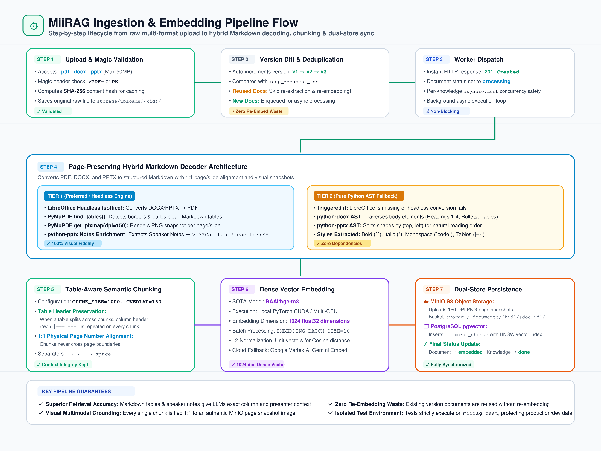
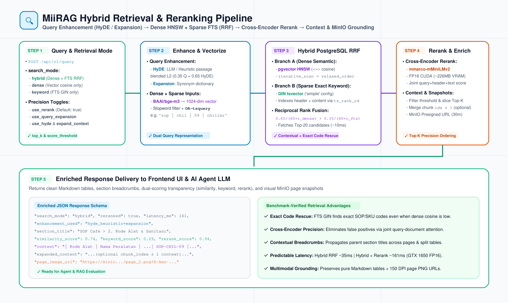

# Alur Pipeline Ingestion, Embedding & Query di MiiRAG

Dokumen ini menjelaskan alur kerja (*end-to-end pipeline flow*) dari saat dokumen pertama kali diunggah hingga tersimpan sebagai vektor berindeks dan dapat di-query secara instan dengan visual grounding.

---

## 1. Diagram Alur Pipeline Embedding



> **Format Vektor:** Gambar diagram alur pipeline di atas juga tersedia dalam format SVG di [`docs/images/embedding_pipeline_flow.svg`](images/embedding_pipeline_flow.svg).

---

## 2. Rincian Tahapan Pipeline Ingestion & Embedding

### Tahap 1: Upload & Pemeriksaan Integritas (*Magic Header Check*)
Setiap file yang dikirimkan ke endpoint `POST /api/v1/knowledges` atau `POST /api/v1/knowledges/{id}/renew` melalui proses validasi ketat di [`app/services/storage_service.py`](../app/services/storage_service.py):
1. **Batas Ukuran:** File diperiksa terhadap batas `MAX_UPLOAD_SIZE_MB` (default: 50MB).
2. **Ekstensi Dokumen:** Format yang diizinkan adalah `.pdf`, `.docx`, `.pptx`, `.xlsx`, dan `.csv`.
3. **Pemeriksaan Magic Byte & Integritas File:**
   * File `.pdf` wajib diawali dengan byte `%PDF-` (`b"%PDF-"`).
   * File `.docx`, `.pptx`, dan `.xlsx` (arsip OpenXML berbasis ZIP) wajib diawali dengan byte `PK\x03\x04` (`b"PK\x03\x04"`).
   * File `.csv` diperiksa agar bukan file biner (tidak mengandung *null byte* `\x00` maupun header PDF/ZIP) dan dapat didekodekan sebagai teks valid (`UTF-8-SIG` / `UTF-8` / `CP1252` / `Latin-1`).
   * Pemeriksaan ini mencegah file berbahaya atau rusak yang sengaja dinamai ulang ekstensinya.
4. **Hashing SHA-256:** Konten file di-hash untuk integritas data dan deteksi duplikasi.

---

### Tahap 2: Manajemen Versi Dokumen (*Diffing*)
Di [`app/services/knowledge_service.py`](../app/services/knowledge_service.py):
1. Saat knowledge dibuat pertama kali, versi ditetapkan ke `v1`.
2. Saat terjadi pembaruan (*renew*):
   * Nomor versi dinaikkan (`v1` &rarr; `v2` &rarr; `v3`).
   * Dokumen yang terdapat pada `keep_document_ids` **tidak diproses ulang** (tidak membuang resource GPU/CPU).
   * Hanya dokumen baru yang ditambahkan ke antrean ekstraksi.

---

### Tahap 3: Dispatch Worker Asynchronous
Di [`app/services/worker_service.py`](../app/services/worker_service.py):
1. Endpoint API segera mengembalikan respon HTTP `201 Created` dengan status `processing`.
2. Fungsi `enqueue_version_embedding()` mendaftarkan task di background event loop (`asyncio.create_task`).
3. Dilengkapi `_knowledge_locks: dict[uuid.UUID, asyncio.Lock]` per knowledge untuk memastikan proses berjalan aman tanpa tabrakan antar-request (*thread-safe & concurrency-safe*).

---

### Tahap 4: Dekoder Dokumen Hibrida Dua Tingkat (*Hybrid Two-Tier Decoder*)
Di [`app/services/pdf_service.py`](../app/services/pdf_service.py), sistem menerapkan strategi dua tingkat untuk menjamin kualitas layout sekaligus kehandalan sistem:

```
                          [ Dokumen Masuk (.pdf / .docx / .pptx) ]
                                            |
                      +---------------------+---------------------+
                      |                                           |
             [ Format PDF Asli ]                      [ Format DOCX / PPTX ]
                      |                                           |
                      |                                Cek LibreOffice (soffice)?
                      |                                           |
                      |                         +-----------------+-----------------+
                      |                         |                                   |
                      |                  [ Ya (Tersedia) ]                   [ Tidak / Gagal ]
                      |                         |                                   |
                      |               Konversi Headless ke PDF                      |
                      |                         |                                   |
                      +-------------------> [ TIER 1 ]                              |
                                                |                                   |
                                  - PyMuPDF find_tables()                           |
                                  - PyMuPDF render PNG 150 DPI                      |
                                  - python-pptx Catatan Presenter                   |
                                                |                                   |
                                                v                                   v
                                     [ Hasil Page Markdown ]             [ TIER 2: Fallback AST ]
                                     + [ PNG Snapshots MinIO ]           - python-docx traversal
                                                                         - python-pptx spatial sort
                                                                         - Embedded image blobs
```

#### A. Tingkat Utama (Tier 1: High Fidelity Headless Conversion)
* **Dokumen DOCX & PPTX:** Dikonversi ke PDF sementara menggunakan LibreOffice headless (`soffice --headless --convert-to pdf`).
* **Kelebihan:** Tata letak fisik halaman, flowchart visual, font styling, bagan, dan tabel dipertahankan persis sesuai aslinya.
* **Rendering Snapshot Gambar:** Setiap halaman (atau slide presentasi) dirender menjadi gambar **PNG beresolusi 150 DPI** menggunakan PyMuPDF (`page.get_pixmap(dpi=150)`).
* **Deteksi Tabel Otomatis:** PyMuPDF mendeteksi struktur garis batas tabel (`page.find_tables()`) dan mengubah grid 2 dimensi sel tersebut ke sintaks Markdown (`|---|---|`).
* **Pengayaan Catatan Presenter (*Speaker Notes Enrichment*):** Untuk file PowerPoint, catatan presenter diekstrak menggunakan `python-pptx` dan disisipkan di akhir konten slide sebagai blockquote (`> **Catatan Presenter:**`).

#### B. Tingkat Cadangan (Tier 2: Pure Python AST Traversal)
Jika LibreOffice tidak terpasang di server atau konversi mengalami kegagalan:
* **Word (DOCX):** Diurai langsung oleh `python-docx` secara berurutan (*sequential AST*): paragraf, heading level 1-4, bullet list, run styling (bold, italic, monospace), dan tabel.
* **PowerPoint (PPTX):** Diurai langsung oleh `python-pptx`: mengurutkan shapes berdasarkan posisi vertikal dan horizontal `(top, left)` untuk menjaga alur baca, mengekstrak tabel, dan bullet points bertingkat.

#### C. Direct Structured Spreadsheet Parser (`.xlsx` & `.csv`)
Di [`app/services/spreadsheet_service.py`](../app/services/spreadsheet_service.py), file Excel dan CSV **tidak dikonversi ke PDF** agar tabel lebar tidak terpotong ke samping dan tanpa membuat snapshot gambar MinIO:
* **Excel (`.xlsx`) via `openpyxl` (`data_only=True`):** Membaca nilai hasil formula per sheet non-kosong, menerapkan *Smart Auto-Unmerge* (mengisi turun *vertical merge* namun menjaga banner judul tunggal tetap sebagai heading `##`), memisahkan beberapa blok tabel/teks bebas per sheet, dan memformat angka/tanggal secara rapi.
* **CSV (`.csv`):** Mendeteksi encoding (`UTF-8-SIG`, `UTF-8`, `CP1252`, `Latin-1`) dan delimiter otomatis (`,`, `;` ekspor Excel lokal Indonesia, `\t`, `|`).
* **Dual-Representation Embedding:**
  * `content` disimpan sebagai **Tabel Markdown rapi** dengan pengulangan header kolom di setiap pecahan chunk (untuk tampilan Frontend & dibaca LLM Agent).
  * `search_text` disimpan dalam format **Row-Semantic Key-Value** (`Baris N: Kolom1: Nilai1 | Kolom2: Nilai2`) sehingga `BAAI/bge-m3` dan *Cross-Encoder Reranker* mengaitkan setiap nilai sel langsung dengan nama kolomnya, dibatasi agar selalu muat dalam `CHUNK_SIZE`.

---

### Tahap 5: Table-Aware Semantic Chunking
Pemotongan teks konvensional sering memotong tabel di tengah baris, sehingga baris data kehilangan baris header kolom dan AI Agent tidak dapat memahami arti data tersebut.

MiiRAG mengatasi ini dengan algoritma **Table-Aware Chunking** di fungsi `chunk_pdf_pages()`:
* **Ukuran Standar:** `CHUNK_SIZE = 1000` karakter, `CHUNK_OVERLAP = 150` karakter.
* **Penjaga Batas Halaman Fisik:** Pemotongan teks **tidak pernah melompati batas halaman**. Chunk halaman 1 tidak akan pernah tercampur dengan halaman 2. Hal ini menjamin hubungan 1:1 antara potongan teks dengan gambar snapshot di MinIO.
* **Pengulangan Header Tabel Otomatis:** Jika tabel panjang melebihi kapasitas `CHUNK_SIZE`:
  1. Tabel dipecah per baris (`\n`).
  2. Baris pertama (header kolom) dan baris pemisah (`|---|---|`) **diulang otomatis pada setiap pecahan chunk**.
  3. Hasilnya: Setiap chunk tabel yang tersimpan di vector database selalu memiliki konteks kolom yang utuh bagi embedding model dan LLM.

---

### Tahap 6: Pembuatan Vektor Embedding (BAAI/bge-m3)
Di [`app/services/embedding_service.py`](../app/services/embedding_service.py):
1. Model yang digunakan: **`BAAI/bge-m3`** (salah satu model open-source embedding multibahasa terbaik, sangat unggul untuk Bahasa Indonesia dan dokumen teknis).
2. Teks diubah menjadi vektor padat berdimensi **1024** (*dense float vector*).
3. Menggunakan PyTorch dengan akselerasi hardware CUDA (jika ada GPU) atau multi-threading CPU yang optimal.
4. Vektor dinormalisasi menggunakan L2 unit norm agar kompatibel sempurna dengan kalkulasi Cosine Distance.

---

### Tahap 7: Sinkronisasi Lapisan Penyimpanan Ganda (*Dual Storage Sync*)
1. **MinIO Object Storage:**
   * Setiap gambar PNG snapshot halaman diunggah ke MinIO dengan nama objek:
     `documents/{knowledge_id}/{doc_id}/page_{page_number}.png`
2. **PostgreSQL pgvector:**
   * Seluruh chunk teks beserta nilai embedding-nya dimasukkan ke tabel `document_chunks`.
3. **Pembaruan Status:**
   * Dokumen diubah statusnya menjadi `embedded`.
   * Status Knowledge diperbarui menjadi `done`.

---

## 3. Alur Query & Retrieval



> **Format Vektor:** Gambar diagram alur query di atas juga tersedia dalam format SVG di [`docs/images/query_retrieval_flow.svg`](images/query_retrieval_flow.svg).
>
> 📖 **Dokumentasi Mendalam:** Penjelasan detail mengenai 3 mode retrieval (`hybrid`, `dense`, `keyword`), rumus RRF, *Cross-Encoder Reranking*, *Query Expansion*, *HyDE*, *Expand Context*, dan hasil benchmark tersedia di [**`RETRIEVAL_METHODS.md`**](RETRIEVAL_METHODS.md).

### Ringkasan Langkah Pemrosesan Query (`POST /api/v1/query`):
1. **Penerimaan Query & Konfigurasi Mode:** Client atau UI mengirimkan query beserta mode (`hybrid` default, `dense`, atau `keyword`) serta toggle opsional (`use_rerank`, `use_query_expansion`, `use_hyde`, `expand_context`).
2. **Query Enhancement & Vectorization:**
   * Jika `use_hyde=true`, pertanyaan ditransformasikan menjadi paragraf hipotetis lalu di-blend secara L2 (`0.35 * query + 0.65 * hyde`).
   * Untuk mode `hybrid` / `dense`, query diubah menjadi vektor 1024 dimensi oleh `BAAI/bge-m3`.
   * Untuk cabang FTS (`hybrid` / `keyword`), stopword ringan disaring menjadi `OR-tsquery` (diperkaya sinonim jika `use_query_expansion=true`).
3. **Hybrid Retrieval di PostgreSQL:**
   * Menjalankan pencarian paralel **Dense Vector (`pgvector` HNSW)** + **Sparse Full-Text (`GIN tsvector`)** lalu menggabungkannya dengan **Reciprocal Rank Fusion (RRF)**.
4. **Cross-Encoder Reranking & Context Expansion:**
   * Jika `use_rerank=true`, Top-20 kandidat dinilai ulang oleh `cross-encoder/mmarco-mMiniLMv2-L12-H384-v1` (menggunakan `contextual_header + content`).
   * Jika `expand_context=true`, chunk tetangga (`chunk_index ± 1`) digabungkan ke field `expanded_content`.
5. **Penandatanganan URL Snapshot & Pengiriman Hasil:** MinIO menghasilkan **Presigned URL** (30 menit) untuk visual grounding, lalu hasil JSON lengkap (`content` Markdown, `section_title`, skor, dan `page_image_url`) dikembalikan ke client atau AI Agent.
