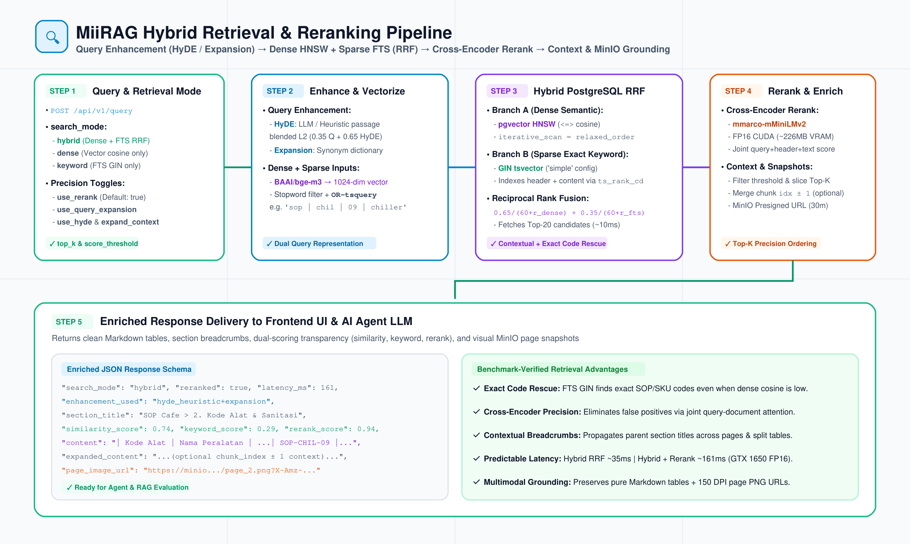

# Metode Query & Retrieval di MiiRAG

Dokumen ini menjelaskan secara menyeluruh seluruh metode pencarian (*retrieval*), peningkatan query (*query enhancement*), pemeringkatan ulang (*reranking*), ekspansi konteks, serta evaluasi kuantitatif yang tersedia pada endpoint `POST /api/v1/query` maupun antarmuka **Query Knowledge** di Frontend.

---

## 1. Diagram Alur Retrieval End-to-End



> **Format Vektor:** Diagram di atas juga tersedia dalam format vektor SVG di [`docs/images/query_retrieval_flow.svg`](images/query_retrieval_flow.svg).

---

## 2. Fondasi Konteks Saat Indexing: *Contextual Chunk Headers*

Agar retrieval akurat bahkan pada potongan teks pendek (*bullet points*, pecahan tabel, atau paragraf dengan kata ganti), [`chunk_pdf_pages()`](../app/services/pdf_service.py) melacak hierarki heading Markdown aktif (`#`, `##`, `###`, `####`) lintas halaman untuk setiap chunk:

```markdown
[Dokumen: SOP_Cafe_Operasional.pdf | Halaman: 2 | Bagian: Standar Operasional Prosedur Cafe > 2. Kode Alat & Sanitasi]

| Kode Alat | Nama Peralatan | Frekuensi Pembersihan |
|---|---|---|
| SOP-CHIL-09 | Chiller Susu Segar | Cek suhu 2°C - 4°C setiap 4 jam |
```

* **Konten Chunk (`content`):** Disimpan tetap dalam format **Markdown murni** (tanpa header tambahan), sehingga tabel tetap valid saat dirender di Frontend atau dibaca AI Agent LLM.
* **Vektor Embedding (`embedding`):** Di [`_embed_single_document()`](../app/services/worker_service.py), model `BAAI/bge-m3` meng-embed gabungan `[contextual_header] + content`.
* **Indeks Kata Kunci (`tsv`):** Kolom `tsv` di PostgreSQL (`GENERATED ALWAYS AS (...) STORED`) otomatis mengindeks `metadata_json->>'contextual_header'` bersama `content` menggunakan konfigurasi `'simple'` dan indeks **GIN**.

---

## 3. Mode Retrieval (`search_mode`)

MiiRAG menyediakan 3 mode retrieval yang dapat dipilih lewat dropdown **Mode Retrieval** di UI atau parameter JSON `search_mode`:

### A. `hybrid` — Hybrid Search: Vector + Keyword RRF *(Default & Direkomendasikan)*
Menggabungkan keunggulan pencarian semantik **Dense Vector (`pgvector` HNSW)** dan pencocokan kata kunci eksak **Sparse Full-Text Search (`PostgreSQL tsvector` GIN)** melalui algoritma **Reciprocal Rank Fusion (RRF)** di [`search_hybrid_chunks()`](../app/repositories/query_repo.py):

1. **Cabang Dense (`dense_candidates`):** Mencari kandidat terdekat menggunakan operator jarak kosinus `<=>` pada indeks HNSW (`iterative_scan = relaxed_order`).
2. **Cabang Sparse (`sparse_candidates`):** Memfilter stopword ringan Indonesia/Inggris lalu membentuk ekspresi `OR` pada [`build_or_tsquery()`](../app/repositories/query_repo.py) (contoh: `"Apa fungsi SOP-CHIL-09?"` &rarr; `'fungsi' | 'sop' | 'chil' | '09'`) dan menghitung skor kepadatan `ts_rank_cd(dc.tsv, to_tsquery('simple', :tsq), 32)`.
3. **Reciprocal Rank Fusion (RRF):** Menggabungkan kedua peringkat dengan bobot default `w_dense = 0.65`, `w_sparse = 0.35`, dan konstanta `k = 60`:
   $$\text{RRF}(d) = \frac{0.65}{60 + \text{rank}_{\text{dense}}(d)} + \frac{0.35}{60 + \text{rank}_{\text{sparse}}(d)}$$
4. **Exact Code Rescue:** Jika sebuah chunk memiliki kode spesifik (misal `SOP-CHIL-09`, `HR-CUTI-04`) sehingga skor kosinus dense rendah di bawah `score_threshold`, hasil tersebut tetap dapat terselamatkan oleh cabang FTS apabila lolos ambang skor kata kunci atau verifikasi Reranker.

### B. `dense` — Dense Vector (`pgvector`)
Menggunakan pencarian vektor murni `BAAI/bge-m3` (1024 dimensi) dengan filter keras `(dc.embedding <=> query_vec) <= (1 - score_threshold)` langsung pada indeks HNSW. Cocok jika query bersifat konseptual penuh dan ingin mempertahankan perilaku pure-vector klasik.

### C. `keyword` — Keyword Only (`FTS`)
Menggunakan pencarian leksikal penuh PostgreSQL (`GIN tsvector`) tanpa melakukan *inference* embedding model untuk query (`embed_query` dilewati). Sangat cepat (< 5 ms) dan cocok ketika pengguna hanya mencari nomor kode, ID dokumen, atau istilah eksak.

---

## 4. Fitur Peningkatan Presisi & Konteks (Toggles UI & API)

Pada antarmuka **Query Knowledge** maupun payload JSON `/api/v1/query`, tersedia 4 fitur opsional berikut:

| Opsi UI / Parameter API | Default | Implementasi Modul | Fungsi & Dampak Performa |
| :--- | :---: | :--- | :--- |
| **Cross-Encoder Reranker**<br>(`use_rerank`) | `true` | [`rerank_service.py`](../app/services/rerank_service.py) | Mengambil hingga `RERANK_CANDIDATE_LIMIT` (20) kandidat awal dari Hybrid/Dense, lalu menilai ulang pasangan `(query, contextual_header + content)` secara bersama-sama menggunakan model **`cross-encoder/mmarco-mMiniLMv2-L12-H384-v1`** (multilingual termasuk Bahasa Indonesia, `FP16` CUDA ~226 MB VRAM / fallback CPU). Menghasilkan `rerank_score` (`0.0 - 1.0`) untuk menyaring *false positive*. |
| **Query Expansion**<br>(`use_query_expansion`) | UI: `true`<br>API: `false` | [`query_enhancement_service.py`](../app/services/query_enhancement_service.py) | Menambahkan sinonim dan kepanjangan singkatan domain secara lokal (*zero-latency*) sebelum pencarian FTS, misalnya `sop` &rarr; `standar, operasional, prosedur`, `edc` &rarr; `mesin, pembayaran, kartu, settlement`, `checklist` &rarr; `daftar, periksa, harian`. |
| **HyDE (Hypothetical Doc)**<br>(`use_hyde`) | `false` | [`query_enhancement_service.py`](../app/services/query_enhancement_service.py) | Mengubah pertanyaan pendek/abstrak menjadi paragraf jawaban hipotetis bergaya dokumen SOP, lalu menggabungkan vektor query asli dan vektor HyDE secara L2-normalized (`0.35 * query + 0.65 * hyde`). Jika `HYDE_LLM_PROVIDER=none`, menggunakan transformasi heuristik deklaratif cepat (< 1 ms); mendukung integrasi LLM opsional (`gemini`, `openai`, `ollama`). |
| **Expand Context**<br>(`expand_context`) | `false` | [`fetch_adjacent_chunks_map()`](../app/repositories/query_repo.py) | Mengambil chunk tetangga (`chunk_index - 1` dan `chunk_index + 1`) dari dokumen yang sama dalam satu query SQL batch, lalu menggabungkannya secara rapi ke field `expanded_content` tanpa mengubah `content` asli. Berguna saat AI Agent LLM membutuhkan konteks paragraf sebelum/sesudahnya. |

---

## 5. Referensi API (`POST /api/v1/query`)

### Contoh Request JSON
```json
{
  "query": "Apa jadwal perawatan kode SOP-CHIL-09?",
  "knowledge_ids": ["8abda18f-8ad8-4826-ad23-6759a2061f72"],
  "top_k": 5,
  "score_threshold": 0.35,
  "search_mode": "hybrid",
  "use_rerank": true,
  "use_query_expansion": true,
  "use_hyde": false,
  "expand_context": false
}
```

### Struktur Response & Interpretasi Skor
```json
{
  "query": "Apa jadwal perawatan kode SOP-CHIL-09?",
  "latency_ms": 161,
  "total_results": 1,
  "search_mode": "hybrid",
  "reranked": true,
  "enhancement_used": "expansion",
  "hyde_document": null,
  "results": [
    {
      "chunk_id": 42,
      "knowledge_id": "8abda18f-8ad8-4826-ad23-6759a2061f72",
      "knowledge_name": "SOP Operasional",
      "version": 1,
      "document_id": "2c8d1f7a-...",
      "filename": "SOP_Cafe_Operasional.pdf",
      "page_number": 2,
      "chunk_index": 1,
      "section_title": "Standar Operasional Prosedur Cafe > 2. Kode Alat & Sanitasi",
      "content": "| Kode Alat | Nama Peralatan | Frekuensi Pembersihan |\n|---|---|---|\n| SOP-CHIL-09 | Chiller Susu Segar | Cek suhu 2°C - 4°C setiap 4 jam |",
      "expanded_content": null,
      "similarity_score": 0.6142,
      "keyword_score": 0.2857,
      "rerank_score": 0.9412,
      "page_image_url": "https://minio.../page_2.png?X-Amz-..."
    }
  ]
}
```

* **`similarity_score` (`0.0 - 1.0`):** Cosine similarity vektor dari `BAAI/bge-m3` di `pgvector`.
* **`keyword_score` (`0.0 - <1.0`):** Skor relevansi kata kunci `ts_rank_cd(..., 32)` dari PostgreSQL GIN FTS (bernilai `null` pada mode `dense`).
* **`rerank_score` (`0.0 - 1.0`):** Skor probabilitas *Cross-Encoder* yang menjadi pengurut utama ketika `use_rerank=true` (bernilai `null` jika reranker dinonaktifkan).

---

## 6. Panduan Pemilihan Strategi (*Decision Matrix*)

| Skenario Penggunaan | Mode & Toggle Disarankan | Alasan |
| :--- | :--- | :--- |
| **AI Agent / Chatbot Produksi Umum** | `hybrid` + `use_rerank=true` + `use_query_expansion=true` | Keseimbangan terbaik antara akurasi semantik, ketepatan kode eksak, dan penyaringan *false positive* (~160 ms). |
| **Pencarian Ultra-Cepat Tanpa Rerank GPU/CPU** | `hybrid` + `use_rerank=false` | Tetap unggul untuk kode & semantik dengan latency ~35 ms. |
| **Pencarian Nomor Seri / Kode Dokumen Persis** | `keyword` + `use_rerank=false` | Tidak memanggil embedder sama sekali (< 10 ms), murni pencocokan indeks GIN `tsvector`. |
| **Pertanyaan Konseptual / Abstrak Panjang** | `hybrid` + `use_rerank=true` + `use_hyde=true` | Menjembatani gap gaya bahasa antara pertanyaan pendek dan kalimat deklaratif dokumen. |
| **Butuh Konteks Paragraf Penuh untuk LLM** | Tambahkan `expand_context=true` | Memberikan chunk sebelum & sesudah pada `expanded_content` tanpa memecah kebersihan chunk asli. |

---

## 7. Benchmark Evaluasi Kuantitatif (`scripts/evaluate_rag.py`)

MiiRAG dilengkapi modul evaluasi di [`app/evaluation/rag_eval.py`](../app/evaluation/rag_eval.py) dan script benchmark [`scripts/evaluate_rag.py`](../scripts/evaluate_rag.py) untuk mengukur **Hit Rate@K**, **MRR** (*Mean Reciprocal Rank*), **NDCG@K**, serta **Avg Latency**.

Hasil benchmark lokal pada database test (`miirag_test`) dengan model `BAAI/bge-m3` + `mmarco-mMiniLMv2-L12-H384-v1` (NVIDIA GTX 1650 FP16, `top_k=3`, `score_threshold=0.25`):

| Konfigurasi Pipeline | Hit@3 | MRR | NDCG@3 | Avg Latency |
| :--- | :---: | :---: | :---: | :---: |
| `Dense Only (Baseline)` | 100.00% | 1.0000 | 1.0000 | 31.8 ms |
| `Hybrid (Dense+FTS RRF)` | 100.00% | 1.0000 | 1.0000 | 35.4 ms |
| `Hybrid + Reranker` | 100.00% | 1.0000 | 1.0000 | 161.0 ms |
| `Hybrid + Rerank + HyDE` | 100.00% | 1.0000 | 1.0000 | 192.2 ms |

Untuk menjalankan ulang benchmark pada lingkungan Anda:
```bash
uv run python scripts/evaluate_rag.py
```

---

## 8. Konfigurasi Environment Terkait

Variabel berikut dapat disesuaikan melalui file `.env` (lihat [`.env.example`](../.env.example)):

```env
DEFAULT_SEARCH_MODE=hybrid
HYBRID_RRF_K=60
HYBRID_DENSE_WEIGHT=0.65
HYBRID_SPARSE_WEIGHT=0.35

RERANK_ENABLED=true
RERANK_MODEL=cross-encoder/mmarco-mMiniLMv2-L12-H384-v1
RERANK_DEVICE=cuda
RERANK_CANDIDATE_LIMIT=20
PRELOAD_MODELS=true

HYDE_LLM_PROVIDER=none
HYDE_LLM_MODEL=gemini-2.5-flash
HYDE_API_KEY=
HYDE_BASE_URL=
HYDE_TIMEOUT_SECONDS=5.0
```
